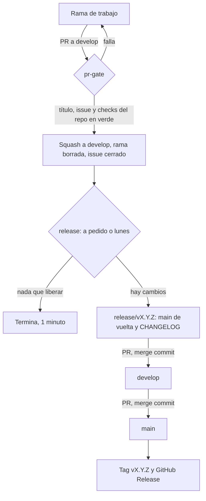

# 0001. Un solo sistema de versionado, heredado desde este repo

- Estado: aceptado
- Fecha: 2026-11-12
- Seguimiento: Nashei-Studios/studio#26

## Contexto

La organización tiene 12 repos y tres personas, cada una con sus agentes. Al 12 de noviembre solo
tres repos tenían `develop`, releases y CI; los otros nueve no tenían ni un workflow. Las reglas
vivían en la configuración de Victor, así que Nande y Leon no tenían forma de seguirlas sin
conocerlas. Victor pidió un único sistema, el mismo en todos los repos, públicos y privados, que se
herede en vez de copiarse y que gaste los menos minutos posibles.

Restricciones medidas:

- Plan gratis. En un repo privado la API de rulesets responde 403 y GitHub no aplica las reglas.
- 2.000 minutos de Actions al mes para los repos privados; cada job se cobra como un minuto mínimo.
- Los agentes mergean solos: una regla no puede exigir una aprobación humana.

## Decisión 1: modelo de ramas

| Opción | A favor | En contra |
|---|---|---|
| Trunk o GitHub Flow (solo `main`) | El más simple; lo que recomienda DORA para equipos que despliegan seguido | `main` siempre desplegable exige pruebas que los juegos no tienen: lo jugable se verifica a mano en Studio |
| GitHub Flow con release-please | La PR de release junta los cambios y un humano decide cuándo sale | Igual que arriba, y release-please asume una sola rama permanente |
| **`main` + `develop` (elegida)** | `develop` recibe todo y `main` es lo último verificado; el corte de release es el momento de probar en Studio | Una rama más; las PR llevan `--base develop`; GitHub no cierra issues al mergear a `develop` |
| Gitflow completo (release y hotfix de larga vida) | Varias versiones vivas a la vez | Nadie mantiene dos versiones de un juego de Roblox |

Se mantiene `main` + `develop` (ADR 0025 y 0026 de la configuración de Victor). Los repos de
documentos también lo usan: cuesta poco y evita tener dos reglas.

## Decisión 2: quién calcula la versión y el changelog

| Opción | A favor | En contra |
|---|---|---|
| semantic-release | Totalmente automático | Pensado para publicar paquetes npm; plugins de Node en repos de Luau y Markdown |
| release-please | PR de release revisable; mantenido por Google | Una sola rama; su PR choca con el flujo `develop` a `main` |
| Changesets | Cada cambio describe su impacto | Un archivo extra por PR; pensado para monorepos de npm |
| **git-cliff (elegida)** | Un binario sin runtime, fijado por versión y checksum; lee Conventional Commits, que ya son obligatorios | Solo calcula versión y changelog: la PR, el tag y el Release los hace nuestro workflow |

## Decisión 3: cómo se hereda

| Opción | A favor | En contra |
|---|---|---|
| Copiar los workflows a cada repo | Sin dependencias entre repos | Doce copias que derivan; fue lo que pasó |
| Plantilla de repo | Un clic al crear | Solo sirve al nacer; no actualiza los repos que ya existen |
| Acción de sincronización de archivos | Abre PR en cada repo cuando cambia la fuente | Necesita un token con escritura en todos los repos guardado como secreto |
| **Workflows reutilizables en `.github` (elegida)** | La lógica vive una vez; cada repo tiene un archivo de diez líneas que la llama; un arreglo aquí llega a todos | Si este repo se rompe, se rompen todos: por eso los callers apuntan a `main`, que solo avanza por release después de pasar por `develop` |

Este repo es público, así que cualquier repo privado de la organización puede llamar sus workflows
sin configuración extra. Además sirve los archivos por defecto de la organización: plantillas de
issue y de PR para los repos que no traen las suyas.

Lo que no se puede heredar por referencia (los callers, `dependabot.yml`, el hook `pre-push`, los
ajustes de merge, las etiquetas y los rulesets) lo planta `sync/plant.ps1`, que es idempotente y con
`-Check` informa la deriva sin cambiar nada.

## Decisión 4: protección

Dos rulesets en todo repo, con los mismos nombres: `production` (rama por defecto) y `develop`.
Ambos impiden borrar la rama y reescribir su historia y exigen pull request con cero aprobaciones.
Sin lista de excepciones: una excepción para el rol Write dejaría la regla sin efecto, porque los
tres miembros tienen ese rol o uno mayor.

Para que `develop` pueda exigir PR, el release ya no empuja el changelog directo: lo lleva en una
rama `release/vX.Y.Z` que entra a `develop` por PR.

En un repo privado del plan gratis los rulesets quedan creados pero GitHub no los aplica. Ahí
cubren el hueco `.githooks/pre-push` (antes de salir de la máquina) y `audit-push` (después: guarda
la punta anterior y abre un issue).

## Flujo

## Costo en minutos

Por repo privado y por mes, sin contar los checks propios de un repo con código: una PR cuesta un
minuto (un solo job), el release semanal sin cambios un minuto, `stale` un minuto por semana y
`audit-push` un minuto por push a una rama permanente. Con 20 PR al mes son unos 35 minutos por
repo. Los repos públicos no consumen.

## Consecuencias

- A favor: un repo nuevo queda igual que los demás con un comando; Nande y Leon siguen el flujo
  sin conocer las reglas, porque el gate les dice qué falta.
- En contra: todos dependen de este repo. Un cambio aquí se prueba primero en `develop`.
- En contra: la PR del changelog entra a `develop` con merge commit, la única excepción al squash.
- No se garantiza: en un repo privado un push directo no se impide, se detecta.

## Qué haría cambiar esto

- Si la organización pasa a un plan con rulesets en privados, se quitan el hook y `audit-push`.
- Si un juego llega a tener pruebas que cubran lo jugable, conviene evaluar trunk con release-please.
